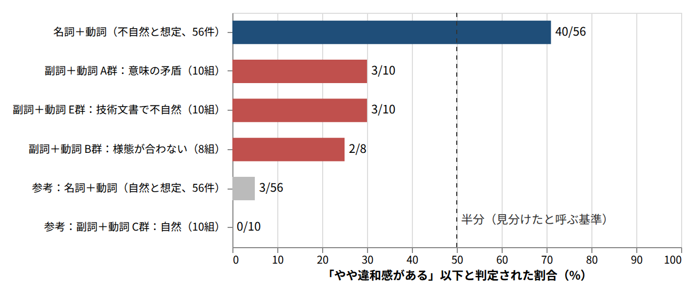

# AIの不自然な日本語を、語のペアの相性で弾こうとした話

## はじめに：結論と、この記事で扱う範囲

語のペアの相性スコアはランダムに語を差し替えた偽のペアと、名詞と動詞の明らかに意味が合わない組を見分けられました。一方で、AI特有の不自然な表現は見分けられなかったかもしれません。後半は確かめきれていないので、仮説としてお読みください。

この記事は、AIが書く日本語の不自然さを、仕組みで検出または修正したい方に向けて書きました。同じ方針に時間をかける前に、何が効かなかったかを知っていただければ幸いです。

数字を読むときは、次の3点にご注意ください。

- 「AUC」とは本物と偽のペアをどれだけ見分けられたかを表す指標です。0.5が偶然で、1が完全です。人間が感じる自然さとは別のものです。
- 実験は乱数の種を変えずに1回ずつ行ったものです。1ポイント未満の差は誤差の範囲です。
- 確認用の例は筆者がAIに頼んで作った少数です。「自然」「不自然」の想定は筆者の判断で、複数の人に確かめたものではありません。AIの出力を集めて測ったものでもありません。

## 背景：AIの文章に出る不自然な言い回し

AIの文章を読んでいて、意味は通るのに、引っかかる言い回しに出会います。筆者の場合は、たとえば「静かに壊れる」です。Claudeがエラーログを出さずに異常終了したコードを、「静かに壊れた」と書いたことがありました。

もう一つは「隣接」です。具体的な文は覚えていませんが、当時のメモが残っています。「隣接した〇〇」は、概念同士が似ている、または近いことを表したくて使われています。「境界」と一緒に使われていて、一瞬なんのことかわからなくなりました。単に似通ったものをどう区別するかという話なのに、という違和感です。「隣り合う」という空間の言葉が、概念の近さに使われていて、何を言いたいのかが読み取れませんでした。

「静かに」という形容や、英語の fails silently を直訳したような言い回しは、AIの文章の特徴です。すでに複数の記事で指摘されています。例は[AIっぽい文章の正体は英語の直訳](https://fyve.co.jp/ai-advisor/articles/ai-text-style-english-calque)と、[Xでよく見る「AI独特の口調」まとめてみた](https://note.com/tachibannna/n/n21a0b3a2ffa1)です。ただし、「静かに壊れる」をそのまま名指しした記事は、筆者は見つけられませんでした。

そこで、次の仮説を立てました。違和感の原因は主語と述語、動詞と目的語などの語のペアの相性の悪さではないかと考えたのです。ならば、ペアの相性をスコアにして、閾値より低いものを機械的に弾けば、AIが文章を直すときの指標になるはずです。

## 方法：語のペアの相性をスコアにする

作ったのは、係り受けの語のペアに、相性の点数を付けるモデルです。仕組みは次の4段階です。

1. 日本語Wikipediaの文から、GiNZA（係り受け解析器）で係り受け（「猫が」→「寝る」のような語のペア）を取り出す。
2. 本物のペアの片方の語を、同じ品詞の別の語に差し替え、偽のペアを作る。差し替える語は出現頻度にそって選びます。この偽のペアを負例と呼びます。
3. 本物と偽のペアを見分けられるように、モデルを学習する。2つの単語ベクトル（係り元と係り先の語を、数百次元の数値で表したもの）を、関係（「が」「を」など）ごとの重みの表（行列）でかけ合わせて点数にするモデルを、双線形モデルと呼びます。語Aと語Bの相性を、関係ごとの重みの表で測るイメージです。
4. 点数が閾値より低いペアを、不自然として弾く。この記事の実験では点数を5段階の判定に直して、閾値の代わりにしました。

最初は単語ベクトルも自前で学習しました。その後、chiVe（日本語の事前学習済みの単語ベクトル）を固定して使う方式にも切り替えました。chiVeを使う版は双線形モデルのほかに、MLP（小さなニューラルネットワーク）も試しました。

確認のために、筆者がAIと一緒に作った表現も用意しました。名詞と動詞の組や、副詞と動詞の組があります。自然な表現と、不自然な表現の両方を入れました。

## 結果1：見分けられたもの

学習データに出てこないペアを、ランダムに差し替えた偽のペアと見分ける精度は、AUCで0.75〜0.79でした（主な設定の範囲）。自前で学習した版は0.790、chiVe版は0.751〜0.774です。

名詞と動詞の明らかに意味が合わない組も、見分けられました。たとえば「ロボットが枯れる」「子供が沸騰する」「石が笑う」は、いずれも「違和感がある」と判定されています。

この判定は日本語Wikipediaのうち、学術や技術の記事だけで学習した版のものです。筆者の目的は業務文書や技術文書の表現のレビューで、小説や詩の比喩が学習に混ざるのを避けたかったためです。判定はモデルごとに作った5段階です。馴染み深い、自然、どちらとも言えない、やや違和感がある、違和感がある、の順に自然さが下がります。

不自然と想定した56件のうち、40件（71%）が「やや違和感がある」以下と判定されました。「どちらとも言えない」は13件、「自然」以上は3件でした。自然と想定した56件のうち、誤って違和感ありとされたのは3件です。

自然な表現と不自然な表現を1組ずつ対にしたものを、最小対と呼びます。最小対でも、結果は良好でした。74組のうち、68組で自然な側の点数が高く、5組で低く、1組は判定できませんでした。

この範囲では、語のペアの相性をスコアにする方針は、狙いどおりに動いたと言えます。

## 結果2：見分けられなかったもの

ところが、副詞と動詞の確認用の例では、結果が変わりました。図1に、確認用の例を群ごとに並べます。名詞と動詞は前節の版の判定、副詞と動詞はMLPの判定です。MLPは2つの単語ベクトルと関係を入力にして点数を出す、小さなニューラルネットワークです。

図1: 名詞と動詞の明らかな不一致は7割が弾けたが、副詞と動詞の確認用の例は3割以下だった。

副詞と動詞の組は、48組を、5つの群に分けて用意しました。意味が矛盾する10組（A群）は、AI特有というより、誰が見ても変な極端な例です。そのうち、「やや違和感がある」以下と判定されたのは3組でした。「静かに騒ぐ」「静かに叫ぶ」「速やかに待つ」「大幅に維持する」「永久に一時停止する」の5組は、「自然」以上と判定されました。残りの2組は「どちらとも言えない」でした。AI特有の不自然さに近いのは、話題は合うが様態が合わない8組（B群）と、技術文書で不自然と想定した10組（E群）です。「やや違和感がある」以下と判定されたのは、B群で2組、E群で3組でした。

自然な一般の表現10組（C群）と、技術文書で普通の表現9組（D群）は、どれも違和感ありと判定されませんでした（D群の1組は判定できませんでした）。校正とはスコアを本物と偽のペアの分布に合わせて、0〜1の確率に直すことです。この判定にはMLPを使い、点数は校正した値です。

個々の表現の判定を、表1に示します。

| 表現 | 筆者の想定 | 学習データでの出現 | 双線形の確率と判定 | MLPの確率と判定 |
| --- | --- | ---: | --- | --- |
| 静かに壊れる | 不自然 | 1回 | 0.56 どちらとも言えない | 0.61 自然 |
| 承認が下りる | 自然 | 19回 | 0.13 違和感がある | 0.21 やや違和感がある |
| 静かに騒ぐ | 不自然 | 0回 | 0.60 自然 | 0.81 馴染み深い |
| 正しく間違える | 不自然 | 0回 | 0.56 どちらとも言えない | 0.82 馴染み深い |
| 大幅に維持する | 不自然 | 0回 | 0.70 自然 | 0.86 馴染み深い |
| 概念が隣接する | 不自然 | 0回 | 0.32 やや違和感がある | 0.44 どちらとも言えない |

表1: 「静かに壊れる」は弾かれず、「承認が下りる」は違和感ありと判定された。

確率は本物らしい側（自然である側）の校正した値です。0に近いほど不自然と判定されたことを表します。

判定は、確率が0.8以上で「馴染み深い」、0.6以上で「自然」、0.4以上で「どちらとも言えない」、0.2以上で「やや違和感がある」、それ未満で「違和感がある」です。

想定と判定が食い違ったのは、想定が不自然なのに弾かれなかった「静かに壊れる」と、想定が自然なのに弾かれた「承認が下りる」です。

「静かに壊れる」は5つのモデルで0.56〜0.68となり、「どちらとも言えない」か「自然」でした。比較に置いた「静かに眠る」は0.62〜0.89です。なぜ弾かれないのかは確かめていません。推測では、「静かに」が多くの動詞と自然に結びつくため、副詞の側の傾向が強く出ている可能性があります。

反対に、「承認が下りる」は5つのモデルで0.13〜0.21と、違和感ありに判定されました。筆者はこれを極めて一般的な表現だと考えます。辞書にも、「認可が下りる」「許可が降りる」という用例があります。普通の表現が不自然と判定された可能性があります。

「概念が隣接する」は0.32〜0.47と低めでした。「建物が隣接する」の0.93〜0.98とは差があります。筆者は一般の方にはあまり自然に見えない表現だと考えます。点数が低いのは筆者の判断と同じ向きですが、弾ける水準ではありませんでした。

この結果は、B群の例がAIの実際の出力を代表しているかどうかに左右されます。そこは確かめていないので、「見分けられなかったかもしれない」にとどめます。

## 改良しても変わらなかったこと

ここまでの結果を受けて、モデルを変えて試しました。偽のペアの見分けやすさ（AUC）は、次の変更ではほぼ動きませんでした。

- 双線形モデルのランク（重みの表の表現力を決める大きさ）を25、50、100に増やす（0.736、0.738、0.739）。
- 負例の数を、本物1に対して1から5にする（0.736、0.732）。
- 出現回数で本物の重みを付ける（0.730）。
- 単語ベクトルを、自前で学習するか、固定するかを変える（0.790、0.751〜0.774）。

基準にしたchiVe版の双線形（ランク100）は0.739でした。どの変更でも、AUCは0.73〜0.79に収まりました。意味が矛盾する例の「静かに騒ぐ」も、自前学習2版と固定ベクトル9版の計11設定のすべてで、「やや違和感がある」以下とは判定されませんでした。

動いたのは、負例の種類を変えたときです。chiVeで意味が近い語に差し替えた偽のペアを近傍語の負例と呼びます。これを学習に混ぜると、ランダムな負例でのAUCは0.774から0.704まで下がりました。「静かに騒ぐ」の確率は0.86から0.72に下がりましたが、「自然」のままでした。評価に近傍語の負例を使うだけでも、同じモデルで0.774から0.648に下がります。評価に使う負例の種類で、指標は大きく動きます。同じ方針を試す方はどの負例で測った数字かに、ご注意ください。

途中で、学習器の欠陥も見つかりました。最適化の設定の影響で、出現が少ない関係の重みの表がゼロに潰れていたのです。直すと、副詞と動詞の関係のAUCは0.632から0.761に上がりました。それでも、AI型の判定は変わりませんでした。

外部のLLMであるArgonに、状況を渡して助言をもらいました。たとえば、語単体の項を足す案です。試しましたが、AUCは±0.001しか動きませんでした。重みの表を、表現力が最大の形（フルランク）にする案は、かえって悪化しました。助言の一部は学習データを確かめると事実と合わず、退けました。

## まとめ：考えられる原因と、意見のお願い

同じ方針を試す方は次の3点を先に確かめてください。

- 評価に使う偽のペアの種類で、数字は大きく動きます。偽のペアを見分けられても、AIの不自然さを検出できたとは限りません。
- 検出したい不自然さの例を、先にAIの出力から集めてください。筆者の確認用の例は少数で、想定も筆者の判断です。
- 閾値を決める前に、「承認が下りる」のような普通の表現が弾かれないかを見てください。

原因はまだ切り分けられていません。候補は2つあります。1つは、モデルや学習データの限界です。「静かに壊れる」は筆者にはペアだけで不自然に感じられますが、モデルは弾けませんでした。もう1つは、文脈が要る不自然さに、ペア単位のスコアが届かないことです。文脈が要ると感じる例は、「課題に向けて」の1例だけです。モデルは「課題に向けて取り組む」を、0.90〜0.91の「馴染み深い」と判定しました。同じ語のペアで、自然な文と不自然な文が分かれる組は、筆者はまだ挙げられていません。

この方針には、限界がありそうだと感じています。ただし、モデルの作りが悪いのか、方針そのものが無理なのかは、切り分けられていません。そこで、ここで一度止めて、ご意見を集めることにしました。LLMに直接判定させる方法とは、比較していません。

ご意見をいただきたい点は次の3つです。

- 文脈を含めて、不自然さを採点する方法はあるでしょうか。
- AIの出力を集めて、検出率を測るよい方法をご存じでしょうか。
- 同じ試みで、うまくいった方はいらっしゃいますか。

コメントでお知らせいただければ幸いです。
