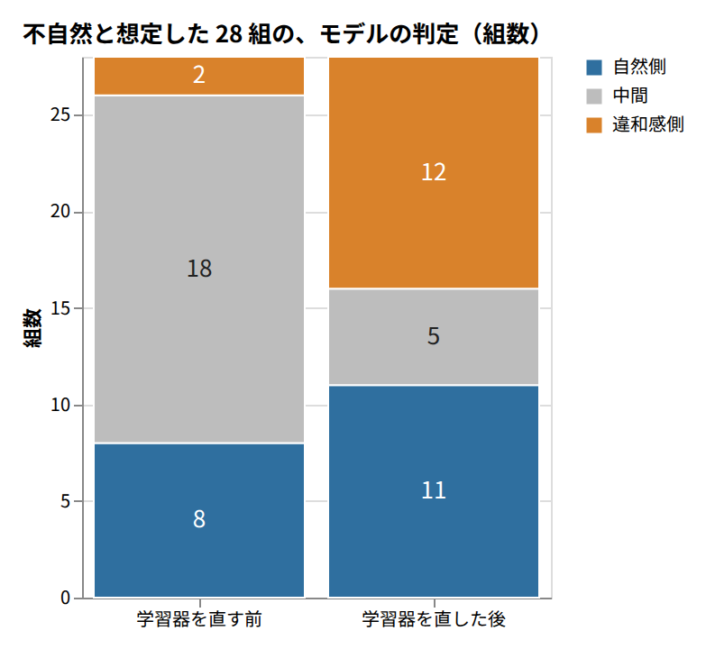

# AIの不自然な日本語を定量的に判定するモデルを作ろうとして失敗した話

## 結論：相性の点数は、人の感覚に届かなかった

AI の文章が不自然なのは、語のペア（主語と述語、副詞と動詞など）の相性が悪いからではないでしょうか。そう仮定して相性を点数にするモデルを作りましたが、人間の感覚に近いレベルで相性の良し悪しを判定することはできませんでした。

私は、AI が書いた日本語の不自然さを点数で測れないかと考えました。ビジネス文書や技術文書のレビューで、機械に「ここが不自然です」と指摘させたかったからです。

結果は次のとおりです。

- 機械的に作った不自然な例を見分ける指標は、悪くない値（満点 1.0 に対して 0.77 前後）でした。
- 私が不自然と判定した表現を、モデルが自然と判定する取り違え（自然と不自然の判定を間違えること）が残りました。
- 私は、見逃し（不自然な表現を自然と判定してしまうこと）を 0 にしたいので、レビューには使えないと判断しました。
- 学習器の欠陥を直し、設定を変えても、この取り違えは直りませんでした。

この記事は AI の出力の日本語を直したい開発者に向けた、断念した試みの記録です。検証は設定ごとに 1 回ずつです。人の判定は、私 1 人が小さな探り文（モデルの判定を確かめるために私が手で作った、短い文や語の組）の集まりに対して行ったものです。この範囲を超えて、次の方法を断定するつもりはありません。

## 作ったもの：係り受けの相性を点数にするモデル

係り受けのペアを関係ごとの双線形モデル（ベクトルに行列をかけて点数を出すモデル）で点数にし、機械的に作った不自然な例との分離を AUC（自然な例と不自然な例を分けられた度合いを表す指標）で測りました。AUC は、0.5 が当てずっぽうで、1.0 が完全な分離です。以下で、その作り方を順に説明します。たとえば「静かに」が「眠る」にかかる関係を、1 つのペアとして扱います。

材料は日本語 Wikipedia です。係り受けの解析には GiNZA（日本語の係り受けを解析するツール）を使いました。単語は chiVe（日本語の単語を固定のベクトルにした学習済みの資源）のベクトルにしました。

点数の出し方は双線形モデルです。係り元と係り先のベクトルに、関係ごとの行列をかけて、1 つの点数を出します。この点数を確率に直し、「自然さ」として読むことにしました。確率は校正（点数を「自然である確率」として読めるように補正すること）してから使います。

表示は 5 段階にしましたが、この記事では 3 つにまとめます。校正後の確率が 0.6 以上を自然側、0.4 以上 0.6 未満を中間、0.4 未満を違和感側と呼びます。

学習には、負例（モデルに「不自然」と覚えさせるための例）が要ります。観測された係り受けの片方を、同じ関係の別の語に置き換えて、機械的に作りました。

モデルは何種類か作りました。この記事で「最終モデル」と呼ぶのは、学習器を直したあとの双線形モデルです。直した内容は「直しても直らなかったこと」で説明します。ほかに、ニューラルネット（MLP）で点数を出す版と、ベクトルも自分で学習した版（語単位と文節単位）があります。

ここで 1 つ、注意があります。この負例は、人が不自然と感じた文ではありません。置き換えた組み合わせが不自然だと、保証されているわけでもありません。この点が、次の節の話につながります。

## 指標の高さと、人の判断とのずれ

AUC 0.77 は生成した負例との分離を測る値であり、人が感じる自然さの判断とは別物でした。0.77 は当てずっぽうの 0.5 よりは明確に高い値です。それでも、人の判断と合っていたのでしょうか。

学習データに一度も出なかった組み合わせで測ると、AUC は最終モデルで 0.766、MLP 版で 0.772 でした。最小対（自然な文と、その一部だけを変えた文の組）でも、72 組のうち 70 組で、自然なほうの点数が高くなりました。組の中で順位が合うかだけを見るので、1 つの表現が自然かどうかは見ません。指標だけを見れば、悪くない結果です。

そこで、私自身の判定と突き合わせました。モデルの判定は見せずに、表現ごとに「ビジネス文書や技術文書で使う表現として自然か」を答えました。答えは○（自然）、△（どちらとも言えない）、×（不自然）のどれかです。

この記事の数字は次の 3 つの集まりから来ます。

- 副詞と動詞の探り文 48 組。私が自然か不自然かの想定を付けました。不自然と想定したのが 28 組、自然と想定したのが 20 組です。
- 無生物主語（人でないものを主語にした文）の探り文 16 文と、日本語として普通の対照 4 文。
- 私が判定した表現。12 項目と、副詞と動詞の相性を見た 10 項目の 2 組です。AI エージェントが選んだ表現を、私が判定しました。

12 項目の判定では、私が不自然とした 7 項目のうち 3 項目を、モデルは自然側と判定しました。副詞と動詞の相性を見た 10 項目では、不自然とした 5 項目のうち 2 項目が自然側でした。

私が許せる見逃しは 0 件です。1 件でもあれば、この基準では使えません。この基準は私が決めたもので、モデルの弱さと基準の厳しさは、分けて読んでください。AUC が 0.77 のモデルは、この基準を満たせませんでした。

もう 1 点あります。判定者は私 1 人で、ほかの人の判断では確かめていません。それでも、指標と人の判断が別物だったことは、この結果から言えると考えます。

## 誤判定の型：副詞と動詞、慣用句、翻訳調

相性の悪い副詞と動詞 28 組のうち 11 組を自然側にするなど、取り違えが残りました。AI の文章に出やすい型として、出典で支えられたのは翻訳調（外国語を直訳したような日本語）だけです。

### 副詞と動詞の相性

以下は学習器を直したあとの最終モデルの結果です。不自然と想定した 28 組を、モデルは次のように判定しました。

- 自然側が 11 組
- 中間が 5 組
- 違和感側が 12 組

28 組のうち、意味が矛盾する 10 組でも、「静かに騒ぐ」「静かに叫ぶ」「大幅に維持する」の 3 組が自然側でした。自然と想定した 20 組は、すべて自然側でした。

ここで、「矛盾」と「相性」を分けておきます。「静かに壊れる」は、意味が矛盾しているわけではありません。それでも私は、副詞と動詞の相性が悪いと考えています。日本語と英語では言語の性質が違うので、矛盾がなくても、相性が悪いことがあるからです。

英語の fails silently に対応する「壊れ方が静かだ」を、AI らしい直訳として挙げた記事があります（Fyve）。「地味に効いてくる」も、同じ記事が、AI が過剰に使う語として挙げています。

「静かに壊れる」を、モデルは中間（校正後の確率 0.57）と判定しました。「地味に効いてくる」は、私が不自然と判定しましたが、モデルは自然側（0.69）でした。「黙って無視される」も、私は不自然と判定し、モデルは自然側（0.80）でした。

AI の型としての裏づけは弱いままです。副詞と動詞の相性を類型に挙げた独立した出典は、確認できたのが 1 件（Fyve）でした。Qiita の 7 万記事を数えた調査では、「静か」を含む記事が 0.1% から 4.9% に増えています。ただし、AI が書いた文章と、人の書き方の変化は、区別されていません。

### 慣用句

「承認が下りる」は「下りる」を「許可や承認が出る」の意味で使う、慣用的な連語です。ここまでと逆向きの取り違えがこの例で起きました。私が自然と判定したのに、モデルは違和感側（0.32）と判定しました。

ただし、慣用句の誤りを AI の型として挙げた出典は、見つかっていません。この例はモデル側の弱さの例としてだけ扱います。

### 翻訳調

翻訳調は無生物主語（人でないものを主語にした文）などの、外国語を直訳したような日本語です。独立した出典が複数あったのは、この型だけでした。

無生物主語の探り文 16 文のうち、違和感側と判定した数は、モデルによって分かれました。全文書で学習した語のモデルでは 7 文、学術・技術の記事で学習した文節のモデルでは 12 文でした。見分けられる場合があった一方で、AI が書く日本語のレビューに使えるレベルではありませんでした。

表1に、食い違った表現を並べます。筆者の判定は○が自然、×が不自然です。モデルの判定は校正後の確率と、その側です。

| 表現 | 筆者の判定（○自然、×不自然） | 校正後の確率（自然である確率） | モデルの判定 |
| --- | --- | ---: | --- |
| 静かに騒ぐ | × | 0.69 | 自然側 |
| 地味に効いてくる | × | 0.69 | 自然側 |
| 黙って無視される | × | 0.80 | 自然側 |
| 検討が行う | × | 0.94 | 自然側 |
| 静かに壊れる | × | 0.57 | 中間 |
| 承認が下りる | ○ | 0.32 | 違和感側 |

表1: 筆者が不自然とした表現を、モデルは自然側にしていた。

私が不自然としたのは 5 項目で、そのうち 4 項目を、モデルは自然側と判定しました。「静かに騒ぐ」「地味に効いてくる」「黙って無視される」「静かに壊れる」は、副詞を含む例です。「検討が行う」は、次の節で説明します。「承認が下りる」は、逆向きの例です。

## 直しても直らなかったこと

学習器の欠陥を直すと判定は動きましたが、取り違えは残り、形式の限界という最初の結論は誤りでした。

最初、副詞の関係は点数がうまく出ませんでした。私は、「双線形という形式の限界だ」と結論しました。しかし、これは誤りでした。原因は、学習器にありました。

学習器の Adam に、結合 L2（損失に重みの大きさの罰を足す、重み減衰の方法）を足していたのが原因です。Adam では、この罰も勾配と一緒に正規化されます。そのため、データの勾配がほとんどない重みは、毎回の更新で、ほぼ一定の幅ずつ 0 に縮みます。低頻度の関係の行列は、実際に 0 に潰れていました。保存してあった重みでは、25 関係のうち 3 関係です。

AdamW（この減衰を勾配から切り離した学習器）に替えると、副詞の関係（「〜に」）の AUC は 0.632 から 0.761 に上がりました。

探り文の判定も、図1のように変わりました。

図1: 学習器を直すと、違和感側は 2 組から 12 組に増えたが、自然側も 8 組から 11 組に増えた。

不自然と想定した 28 組のうち、違和感側と判定した組が増えたのは、狙いどおりです。一方で、自然側と判定した組も増えました。意味が矛盾する 10 組では、自然側が 3 組のまま変わりませんでした。「取り違えが減った」とは、言えない結果です。

続けて、設定を変えて確かめました。10 設定の内訳は、次のとおりです。

- 行列の大きさ（ランク）3 通り × 損失の種類 2 通りの 6 設定
- 負例の数を変えた 2 設定
- 正例の重みを変えた 1 設定
- MLP 版の 1 設定

学習データに一度も出なかった組み合わせの AUC は 0.748〜0.772 に収まりました。不自然と想定した 28 組のうち自然側とした組は、どの設定でも 10〜12 組でした。取り違えは、設定の調整では直らなかったと考えられます。では、何と対応しているのでしょうか。

手がかりは 2 つあります。1 つ目は、静的ベクトル（1 つの単語に 1 つのベクトルを割り当てる方式）です。この方式では、多義語の意味が 1 つに混ざります。chiVe では、「下りる」は「降りる」と同じベクトルでした。近い語 20 語は、すべて移動を表す語でした。

「〜が下りる」の点数は、名詞と「下りる」のベクトルの近さと、順位相関で 0.50〜0.58 の対応を示しました。中程度の対応です。前の節の「承認が下りる」は、この例にあたります。ただし、ベクトルを差し替えて直るかは、確かめていません。

2 つ目は、係り受けを 1 本ずつ採点する作りです。「検討が行う」は、人が行うことを、「検討」という名詞を主語にして「行う」と言った、不自然な文です。通常版では、「検討が行われる」と同じ点数になります。受身の形を区別する版に替えると、2 つの点数は分かれました。それでも「検討が行う」は、校正後の確率が 0.70 で、自然側のままでした。

どちらも、原因を突き止めたとは言えません。取り違えの一部は、こうした作りと対応して見える、という範囲です。

では、直せば使えるのでしょうか。それとも、形式の限界があるのでしょうか。副詞の関係の点数が低かった主な原因は、学習器の欠陥でした。ただし、直しても取り違えは残りました。形式の限界がどの程度あるのかは、この実験では決められません。

## 同じことを試す前に確かめること

試す前に、指標が測るものを人の判断で確かめ、結論の前に学習器を疑うとよいでしょう。同じことを試すなら、次の 4 点を先に確かめてください。

- 指標が何を測っているかを、人の判断と突き合わせます。負例が機械的に作ったものなら、AUC は人の自然さを測りません。
- 結論を出す前に、学習の不具合を疑います。別の学習器や設定で作り直し、結果が動くかを見ます。私の場合は、Adam の結合 L2 を AdamW に替えると、結論が変わりました。
- 見逃しの許容を先に決め、型ごとの取り違えを数えます。平均の指標では、型ごとの穴が見えません。
- 「AI に出やすい型」は、出典で確かめます。私の場合、独立した出典が複数あったのは翻訳調だけでした。

この実験で確かめたのは、語の組み合わせの相性を 1 本ずつ採点するやり方だけです。ほかのやり方で測れるかどうかは、言えません。

出典は次のとおりです。

- 副詞と動詞の相性：Fyve「AIっぽさの正体は英語の言い回しの直訳」（2026-09-02）
- 言い回しの増加：Qiita の 7 万記事を数えた調査（逆瀬川ちゃん、2026-09-11）
- 翻訳調：japanese-humanizer、robitan の Qiita 記事、Manual Hub の note 記事
