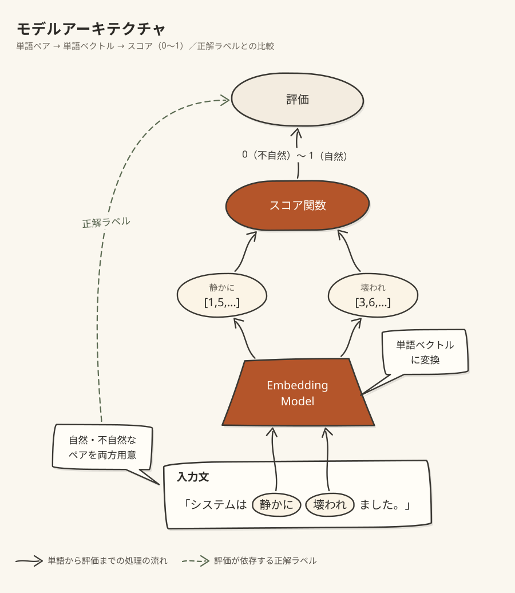
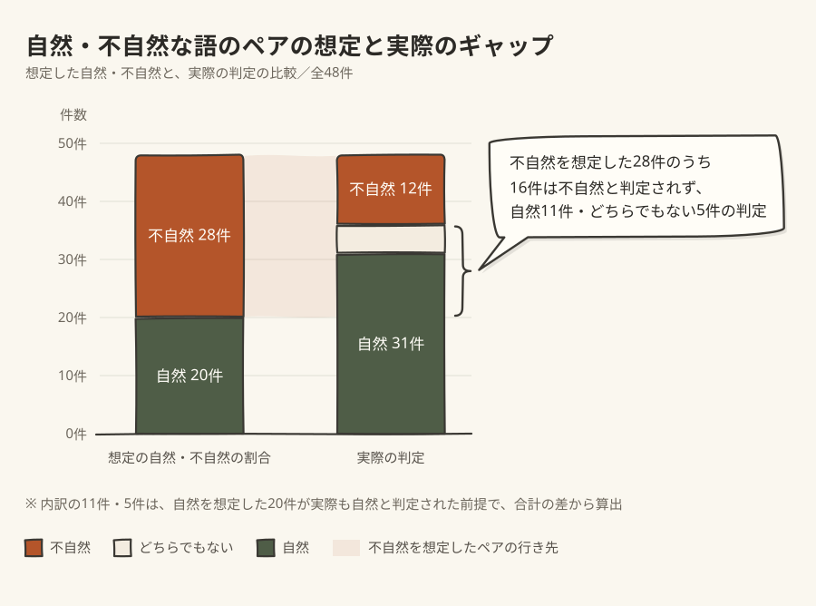

# AI Slopな言葉遣いを判定するモデルを作ろうとした話

## 結論：人間の感覚と同じモデルは作れなかった

みなさんがご存知の通りAIの出力する文章にはかなり違和感があります。本記事では、「違和感が発生する原因の一つが、主語と述語、動詞に係った副詞、名詞に係った形容詞などの語のペアの作り方が馴染みのない組み合わせだからではないか」、という仮説をベースにペアの相性をスコアリングするモデルを作成して評価を行なった結果を共有します。
結論から先に述べると、機械的に作った不自然な例を判定するのはかなりできたが、人間が不自然と感じる表現を自然と、自然と考える表現を不自然と間違えて判定する課題が多く残る、という結果になりました。

## 背景

AIが書く文章が不自然なのはもはや周知の事実だと思います。しかし未だに、AIの文章を人間が書いたような自然な文章にする決定版スキルや仕組みは出ていません。現状あるものの多くが、読みやすくはなりますが、完全にAI臭を消して人間らしい文章に改善できるものではありません。
実際本記事自体と同様の内容のものをAIに執筆させて yomiyasu を適用すると、たしかに読みやすくはなりますが、AIが書いたものだとはっきりわかるようなものになります。

- https://github.com/asuka1975/cyrus-doc-showcase/blob/main/docs/1/final.md
- https://github.com/asuka1975/cyrus-doc-showcase/blob/main/docs/2/final.md

いくら読みやすく、内容が良くとも、AI臭がするだけで読む気が失せてしまう、というのが最近の個人的な悩みでした。そこで作ろうと思ったのが本記事で紹介する、AIが使う違和感のある語のペアの判定モデルです。

## 作ったもの：係り受けの相性を点数にするモデル

作成したモデルは、基本的には以下のような構成をとっています。

今回の検証の中では大きく分けて２種類の手法を検証しており、それぞれスコア関数・Embeddingモデル両方を学習する手法、Embeddingモデルを固定してスコア関数のみを学習する方法を試行しています。

### 1. 双線形関数をベースするスコア関数とEmbeddingモデルの学習 (以降モデル1)

スコア関数は以下のように定義します。

$$ s = v_{mod} ^ T W_r v_{head} + b_r $$

$$ v_{mod}, v_{head} は 埋め込みモデルにより256次元ベクトルに変換された係り受け元、係り受け先の単語ベクトルです。W_r は v_{mod}, v_{head} の関係行列であり、これが二単語間の相性を決める行列となります $$

$$ Embeddingモデルは係り受け元、係り受け先それぞれで専用の行列を e_{mod}, e_{head} として 定義します。サイズは語彙数×256です。$$

$$ それぞれのパラメータの更新則は、\begin{cases}
  g = s - 1 (組み合わせが自然なとき) \\
  g = s (組み合わせが不自然なとき)
\end{cases}
として以下のようになります。$$

| パラメータ | 更新則 |
| --- | --- |
| $$ 係り受け元の単語ベクトル e_{mod, i} $$ | $$ e_{mod, i}' = g \cdot W_r e_{head, j} $$ |
| $$ 係り受け先の単語ベクトル e_{head, j} $$ | $$ e_{head, j}' = g \cdot W_r e_{mod, i} $$ |
| $$ 関係行列 W_r $$ | $$ W_r' = g \cdot ( e_{mod, i} \times e_{head, j}^T) $$ |
| $$ 関係バイアス b_r $$ | $$ b_r = g $$ |

$$ つまり e_{mod, i}, e_{head, j}, W_r は、単語同士が自然な組み合わせなとき、その二単語の関係が近くなるように更新され、不自然なときは遠くなるように更新される、ということです。 $$

Embeddingモデルも単語同士の関係性を考慮した上で更新されるので、未知の語彙には対応できないものの、語同士の相性を効率的にスコアリングできるはずです。

### 2. Embeddingモデルを既存のもので固定したスコア関数の学習 (以降モデル2)

スコア関数はモデル1と同様、以下の式で定義されます。

$$ s = v_{mod} ^ T W_r v_{head} + b_r $$

更新則もモデル1と同様です

モデル1と異なるのは Embeddingモデルで、既存のchiVe, fastTextを用いています。これによって1の手法では欠けていた未知の語彙に対する対応もできるようになっています。

### 学習データ

学習に利用するデータは、日本語 Wikipediaです。学習データの中から [GiNZA](https://megagonlabs.github.io/ginza/) を用いて係り受け関係の単語の組み合わせを抽出し、関係性が自然なペアとします。そこからランダムに片方の単語を置き変えた組み合わせを不自然なペアとします。

このようにしてできた、語のペアと自然・不自然の正解ラベルを学習データとします。

## 指標の高さと人の判断とのズレ

前述のようなモデルをベースに学習を進め、順調に不自然な語の検知率を上げていきました。最終的にどちらのモデルも、不自然な語のペアを7 ~ 8割近く検出できるようになりました。指標だけ見ればこの数字は悪くない数字です。

しかし、実データで検証を行うと、全く逆の結果が現れました。実データ検証で利用するデータは以下のようなもので構成されています。

- 全体は学習データ節で言及した、機械的に作った不自然な副詞と動詞のペアとWikipediaから抽出した自然なペア （不自然なペア：28組、自然なペア：20組）
- 典型的な翻訳調の表現と一般的な表現 （不自然なペア：12組、自然なペア：10組）

それぞれ実際に不自然かどうかを私の方でラベリングを行なった上で検証データとしています。

### 副詞と動詞のペアの判定ミス

以下はモデル2による検証結果で、副詞と動詞のペアのみについて、データ側の想定と実際のモデル2よる判定の比較図です。

元々自然であると想定したペアについては問題なく自然だと判定した一方で、不自然であると想定したペアは、半分以上が誤った判定を下されました。特に意味が矛盾するような組み合わせとして「静かに騒ぐ」「静かに叫ぶ」「大幅に維持する」のような組み合わせが自然であると判定されました。また、典型的なClaude語である「静かに壊れる」や「地味に効いてくる」「黙って無視される」といった表現も、中間的か自然であると判定されました。

### 慣用句の判定ミス

慣用句的な表現は実データ検証の中で一件ありませんでしたが、特徴的だったため独立してまとめます。

「承認が下りる」という表現は、日本語Wikipediaには用例がなかったようですが、「許可が下りる」「認可が下りる」のようなニュアンスでビジネスの現場でも一般的に使われる表現であろうと思われます。実際に私のこの表現は極めて自然かと思いますが、モデル2は不自然と判定しました。

## 考察

今回のモデル学習では、学習データが一部人の校正の入ったデータではありませんでした。自然な表現のペアに関してはWikipediaからそのまま抽出したものであるため妥当性があるデータだと思います。一方で不自然な表現のペアに関しては、Wikipediaにないランダムなペアとはいえ、自然なペアが混ざる可能性があるため、学習データが汚染されている可能性が高いです。

実際副詞と動詞のペアの判定において、自然なペアを正しく見分けられたのに対し、不自然なペアをうまく見分けられなかったのが象徴的です。おそらく不自然だとされているペアのラベル付けがうまくいっていないがために、不自然な表現の判定がうまく行かなかったのだと思われます。

## まとめ

本記事では、AIがやりがちな人間にとっては違和感のある表現を判定するモデルを作成する試みを共有しました。結果としてはうまく行かなかったものの、うまく行かなかったなりに学べるポイントはあったと思います。今後もAI臭のする文章の改善の研究は行なっていくつもりなので暖かく見守ってくだされば幸いです！

## 追走者へのアドバイス

追走者向けに以下のアドバイスを残しておきます

- 学習データは人がラベルをつけたほうが良い
- 学習の評価は単純な語のペアが自然か不自然かではあまりうまく行かなかったので、別の指標を試したほうが良い（例えば登場頻度など）
- AIが使いがちな表現集を作らないと、後続のモデル評価が非常にやりづらい。